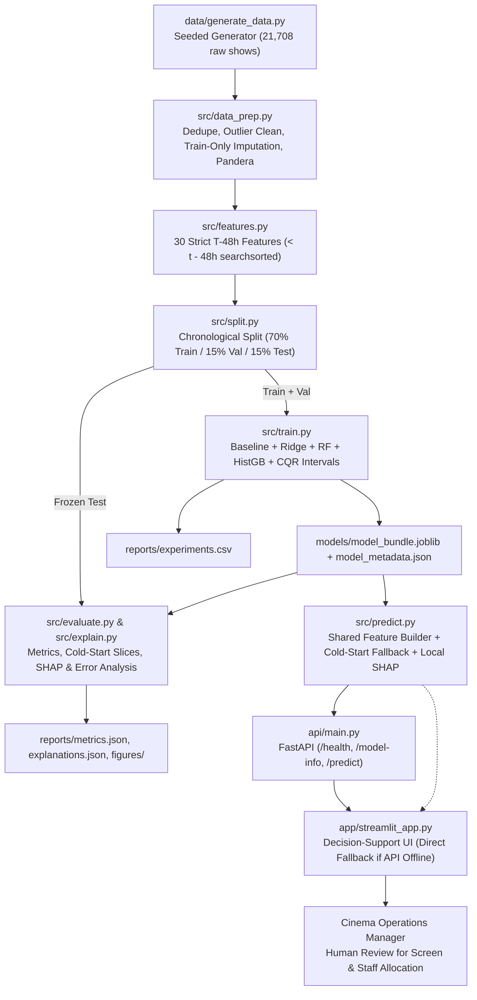

# System Architecture — Cinema Ticket Demand Forecasting (`T-48h`)

## End-to-End Pipeline & Inference Flow

## Key Architectural Guarantees
1. **Zero Training-Serving Skew:** Both FastAPI (`api/main.py`) and Streamlit (`app/streamlit_app.py`) invoke `src.predict.predict_single_show()`, loading the exact `ColumnTransformer` + `HistGradientBoostingRegressor` + CQR quantile models saved in `models/model_bundle.joblib`.
2. **Temporal Isolation:** `src/features.py` enforces strict `< show_datetime - 48h` cutoffs via `np.searchsorted(..., side="left")` before `src/split.py` partitions the timeline into non-overlapping `train`, `val`, and `test` dates.
3. **Human-in-the-Loop Control:** All outputs include uncertainty intervals, cold-start warnings, local SHAP drivers, and an explicit decision-support disclaimer.

